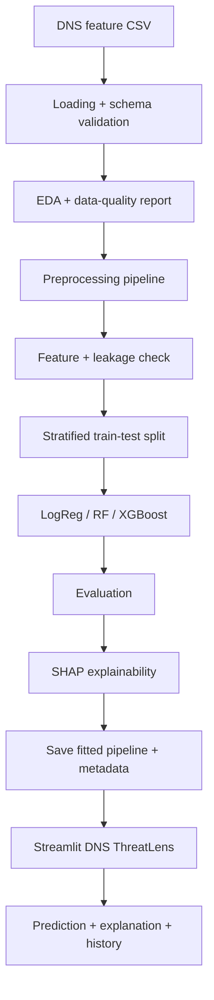

# DNS ThreatLens — Explainable ML-Based Malicious DNS Traffic Detection

Explainable machine learning for DNS-based data exfiltration traffic records. Binary and multiclass classification, model comparison, SHAP explanations, and an offline Streamlit analysis tool.

> **Prediction disclaimer:** outputs are estimates learned from training patterns, not proof that a domain, host, or DNS event is malicious. This system does not detect every DNS attack. It is an offline feature-record tool — no live capture, no DNS resolution, no blocking.

---

## 1. What this project does

Classifies **prepared DNS feature records** (one CSV row = one traffic record with extracted features):

- **Experiment A — Binary:** `benign` vs `attack` (light + heavy exfiltration merged)
- **Experiment B — Multiclass:** `benign` / `light_attack` / `heavy_attack` (only when source labels support three classes)

It compares three models, evaluates honestly on a held-out test set, explains predictions with SHAP, and serves results in a SOC-inspired dashboard.

It does **not**:

- accept a raw domain string as a full traffic record
- resolve domains, fetch URLs, or contact external infrastructure
- parse PCAPs, capture live traffic, block, quarantine, or integrate with a SIEM in v1
- claim real-time detection

A feature mismatch produces a clear validation error, never a silent prediction.

## 2. Dataset

### Primary: CIC-Bell-DNS-EXF-2021

- Official page: https://www.unb.ca/cic/datasets/dns-exf-2021.html
- Download (registration form required): http://cicresearch.ca/CICDataset/CICBellEXFDNS2021/
- Domain: DNS-based data exfiltration, benign + light + heavy attack traffic
- Documented size: 323,698 heavy attack, 53,978 light attack, 641,642 benign structured samples; 30 features (14 stateless + 16 stateful); window τ = 100 packets
- Paper preprocessing (for reference): drop timestamps, NaN → 0, encode categoricals (`rr_type`, `distinct_ip`, `unique_country`, `unique_asn`, `distinct_domains`, `reverse_dns`, `longest_word`, `sld`), `unique_ttl` lists → mean
- Licence: redistribution allowed with citation (verify current terms on official page)
- Citation: Mahdavifar et al., *Lightweight Hybrid Detection of Data Exfiltration using DNS based on Machine Learning*, ICCNS 2021. See `CITATION.cff` and `data/README.md`.

**How to use real data:**

1. Complete the official download form.
2. Place CSVs in `data/` locally (git-ignored, never commit real data).
3. Run:
   ```bash
   PYTHONPATH=. .venv/bin/python -m src.data_loader
   PYTHONPATH=. .venv/bin/python scripts/train_all.py --data data/<REAL_FILE>.csv
   ```
4. Replace synthetic numbers in `reports/REPORT.md` Ch.4/Ch.8 with your audit output.

### Alternatives (scope changes if used)

- CIRA-CIC-DoHBrw-2020 — benign-DoH / malicious-DoH / non-DoH. Task becomes DoH tunneling, different schema.
- CIC-Bell-DNS-2021 — benign vs spam/phishing/malware domains. Task becomes domain reputation, not tunnel traffic.

Do not merge datasets with incompatible schemas. Never invent columns, labels, or download URLs.

### Synthetic demo data (included, clearly labeled)

`data/synthetic_dns_demo.csv` (5000 rows, 28 cols) is **random, synthetic data** following documented feature names so tests, CI, and the app run without the gated download:

```bash
.venv/bin/python -m src.synthetic --n 5000 --out data/synthetic_dns_demo.csv --seed 42
```

Never present synthetic metrics as CIC results.

## 3. Architecture



| Stage | Purpose | Key file |
|---|---|---|
| Loading | Find CSVs, no assumed label name, detect target, normalize `benign/light/heavy` | `src/data_loader.py` |
| Validation | Missing/duplicates/inf, leakage regex, high-cardinality IDs, inference schema check | `src/validation.py` |
| Preprocessing | `clean_frame` (list-mean, inf→NaN), median/most-frequent impute, one-hot unknown-safe, scale only for LogReg | `src/preprocessing.py` |
| Training | Stratified split (test untouched), timing, class weights, save fitted pipeline | `src/train.py`, `scripts/train_all.py` |
| Evaluation | Accuracy, precision/recall/F1, ROC-AUC/PR-AUC, macro/weighted-F1, balanced-acc, confusion matrices | `src/evaluate.py` |
| Explain | Sampled SHAP TreeExplainer, global bar + local bars, binary/multiclass-safe | `src/explain.py`, `scripts/make_shap_figs.py` |
| Inference | Load joblib artifact, validate columns/order, `predict`/`predict_proba`, results CSV | `src/predict.py` |
| App | 5 pages, offline only, SQLite history optional | `app/app.py` |

Stack: Python 3.11, pandas 2.2.2, numpy 1.26.4, scikit-learn 1.5.0, XGBoost 2.0.3, SHAP 0.46.0, Streamlit 1.33.0, joblib, matplotlib/seaborn, PyYAML, pytest. See `requirements.txt`.

## 4. Quickstart

### Local

```bash
python3.11 -m venv .venv
.venv/bin/pip install -r requirements.txt
PYTHONPATH=. .venv/bin/python -m src.synthetic --n 5000 --out data/synthetic_dns_demo.csv --seed 42
PYTHONPATH=. .venv/bin/python scripts/train_all.py
PYTHONPATH=. .venv/bin/python scripts/make_shap_figs.py
PYTHONPATH=. .venv/bin/pytest -q
.venv/bin/streamlit run app/app.py
```

### Google Colab

1. Upload `notebooks/DNS_Malicious_Traffic_Detection.ipynb`.
2. Upload real CSVs to `/content` or mount Drive.
3. Run cells 0→N in order. Cells auto-use real CSV if present, else synthetic demo.

## 5. Results (measured, synthetic demo)

Source: `reports/metrics.json` — `synthetic (DEMO ONLY - not CIC data)`, n=5000, test 20% (1000 rows), seed 42.

**Binary (benign vs attack):**

| Model | Acc | Bal-acc | Prec | Rec | F1 | ROC-AUC | Train s |
|---|---|---|---|---|---|---|---|
| LogReg | 0.998 | 0.998 | 0.998 | 0.998 | 0.998 | 0.9999 | 0.11 |
| RF | 0.998 | 0.998 | 0.998 | 0.998 | 0.998 | 0.9999 | 0.50 |
| XGB | 0.999 | 0.999 | 0.998 | 1.000 | 0.999 | 0.9999 | 0.18 |

XGB confusion: TN 499, FP 1, FN 0, TP 500 (FPR 0.002, FNR 0.0).

**Multiclass (benign/light/heavy):**

| Model | Acc | Bal-acc | Macro-F1 | Weighted-F1 | ROC-OVR |
|---|---|---|---|---|---|
| LogReg | 0.969 | 0.959 | 0.960 | 0.969 | 0.997 |
| RF | 0.970 | 0.961 | 0.961 | 0.970 | 0.996 |
| XGB | 0.970 | 0.961 | 0.961 | 0.970 | 0.997 |

Top SHAP (binary XGB, mean|SHAP|): `rr_name_length`, `numeric`, `upper`, `labels_max`, `len`. See `reports/figures/shap_bar_*.png` and `cm_*.png`.

These prove the pipeline runs, not that real CIC data scores this high. Synthetic classes were constructed separable. Re-run on real CIC data before any academic claim, and investigate leakage/duplicates if real scores look suspiciously high.

## 6. Streamlit app

`app/app.py` — `DNS ThreatLens`:

1. **Overview** — description, model version, schema, test metrics (labeled offline), top features. Distinguishes offline test metrics from user uploads.
2. **Analyze DNS records** — CSV upload, schema validation (missing/extra warnings), predict + scores, download results CSV, optional synthetic demo toggle.
3. **Explain a prediction** — class, scores, SHAP bar, plain-language limits. Scores are model outputs, not calibrated real-world probabilities.
4. **Model evaluation** — loads `reports/metrics.json` + `reports/figures/`, states limitations.
5. **Prediction history** — optional SQLite (`app/history.db`, git-ignored), privacy-minimal columns, clear button.

Theme: clean SOC-style cards, readable charts, severity labels not color-only. Demo rows labeled synthetic.

## 7. Repository structure

```text
malicious-dns-ml-detector/
  app/app.py, app/components/
  src/data_loader.py, validation.py, preprocessing.py, train.py,
      evaluate.py, explain.py, predict.py, synthetic.py
  scripts/train_all.py, make_shap_figs.py
  configs/model_config.yaml
  notebooks/DNS_Malicious_Traffic_Detection.ipynb
  tests/test_features.py, test_preprocessing.py, test_prediction.py
  data/README.md, data/synthetic_dns_demo.csv
  models/README.md (+ generated pipelines, git-ignored)
  reports/REPORT.md, reports/metrics.json, reports/figures/
  docs/VIVA.md
  requirements.txt, .gitignore, README.md, LICENSE, CITATION.cff
```

## 8. Testing

```bash
PYTHONPATH=. .venv/bin/pytest -q
```

Covers: target detection, label normalization, quality report, inf/NaN cleaning, unseen-category safety, feature-order stability, training runs, prediction format, probability shape/ranges, missing-column errors, results-CSV path. 11 tests passing on synthetic data. Training/inference share the same fitted pipeline and ordered `feature_names`.

## 9. Limitations

- Current metrics are synthetic; real CIC evaluation pending gated download.
- No group/temporal split without session/domain IDs; random holdout may overstate generalization.
- Threat drift, class imbalance, FP/FN tradeoffs, uncalibrated scores.
- No PCAP parsing, streaming, threat intel, or SIEM in v1.
- SHAP explains the model, not causation.

See `reports/REPORT.md` Ch.10 and `docs/VIVA.md`.

## 10. Academic use

- Report: `reports/REPORT.md` (Ch.1–11 + abstract, replace Ch.4/Ch.8 with real stats).
- Viva: `docs/VIVA.md` (25 Q&A + 2-min / 5-min demo scripts).
- Notebook: `notebooks/DNS_Malicious_Traffic_Detection.ipynb`.

## 11. Citation and licence

Code: MIT (`LICENSE`). Dataset: CIC-Bell-DNS-EXF-2021 terms + ICCNS 2021 citation, see `CITATION.cff`.
